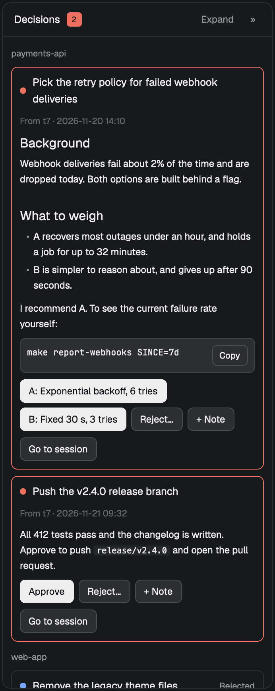

# herdr-mods

[](https://github.com/joecwu/herdr-mods/actions/workflows/test.yml)

Mods I built for [Herdr](https://herdr.dev), the desktop app for terminals and coding agents, and
use every day. [繁體中文](README.zh-TW.md)

| Mod | What it does |
|---|---|
| [decisions](decisions/) | A side panel that collects the decisions your agent sessions are waiting on. Approve, pick an option or reject with a reason; the result goes back to the session. |

### decisions

<a href="decisions/"></a>

## Install

Each mod folder follows Herdr's sharing layout, so you can hand an agent the folder's URL and ask it
to add the mod, or copy it yourself:

```sh
git clone https://github.com/joecwu/herdr-mods.git
cd herdr-mods
./sync install decisions
```

`./sync install` copies the mod into `~/.config/herdr-app/mods/` (or `$HERDR_APP_HOME/mods/`) and
runs `herdr-app check` on it. A mod shows up in the window once a layout places it; each mod's
README has the block to add.

## Repository layout

```
<mod>/
  README.md        what it does and how to set it up
  RECIPE.md        the brief an agent can rebuild the mod from
  preview.png
  mods/<mod>/      the mod itself
  test/            unit tests for its pure modules
sync               copies mods between this repo and the running app
```

## Development

Herdr hot-reloads a mod when a file in its folder is saved, but not when that folder is a symlink.
So mods are edited in place in the app's folder and copied back here:

```sh
$EDITOR ~/.config/herdr-app/mods/decisions/main.js   # saving reloads the mod
herdr-app check ~/.config/herdr-app/mods/decisions   # loads and renders it once
./sync pull decisions                                # app -> repo
npm test                                             # Node 22 or newer, no dependencies
```

Logic that needs no Herdr API lives in its own module (for example `decision-file.js`) so it can be
tested with `node --test`. `main.js` holds the view.

## License

[MIT](LICENSE)
