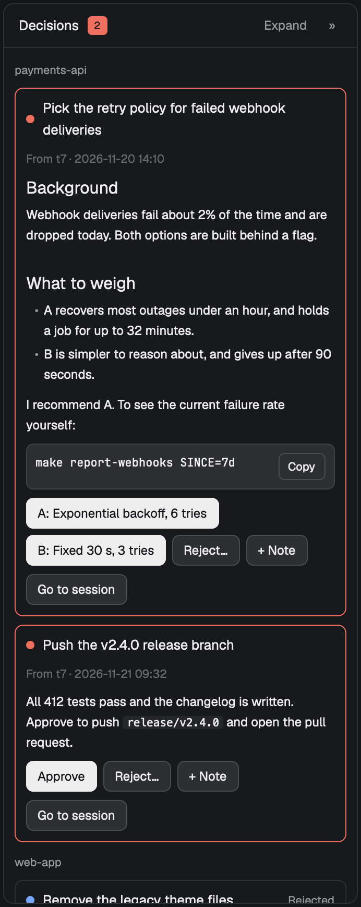

# decisions

A Herdr side panel for the decisions your agent sessions are waiting on. [繁體中文](README.zh-TW.md)



When several agent sessions run at once, their questions end up scattered across chats and you lose
track of what is waiting on you. With this mod, a session that needs a decision writes a small
markdown file in its project. The panel lists every pending file with the context needed to judge
it. You click a choice; the panel records it in the file and tells the session.

## What it does

- Lists `.decisions/*.md` from every project that has an open pane, grouped by project.
- One button per option the session offered, or Approve when it offered none.
- Reject asks for a reason and sends it along, so the session knows how to continue.
- A Copy button beside every code block, for commands you have to run yourself.
- A notification and a Dock badge when a new decision arrives.
- Expands over the tab area for long reads, and folds to a 44 px rail that shows the count.

## How it works

```
session                         panel                          you
  │ writes .decisions/<id>.md     │                              │
  │ (status: pending) ───────────▶│ shows the card, notifies ───▶│
  │                               │◀──────────── clicks a choice │
  │                               │ rewrites the frontmatter     │
  │◀─── hc send <requester> ──────│ (status: decided)            │
  │ re-reads the file, acts,      │                              │
  │ moves it to .decisions/done/ ─▶ card disappears              │
```

The file is the source of truth. The message to the session is only a nudge to read it.

## Setup

1. Install the mod: `./sync install decisions` from the repository root.
2. Add the block to your layout, in the row that holds the tab block (`work-body` in Herdr's `main`
   layout). Shipped layouts are read-only, so clone one first with
   `herdr-app do layout.clone '{"name":"main"}'`.

   ```json
   { "id": "decisions", "type": "block", "content": { "mod": "decisions" }, "size": { "px": 340 }, "min": 44 }
   ```

3. Tell your agents about it: copy [`agent-rule.md`](agent-rule.md) to where your agent reads its
   rules. For Claude Code that is `.claude/rules/decisions.md` in a project, or `~/.claude/rules/`
   for every project.
4. Keep pending files out of git: add `.decisions/` to `.gitignore`, unless you want the record.
5. Optional, for Claude Code: install the guard described below, so an agent that forgets the rule
   is reminded.

### Guard for Claude Code

An agent that has the rule in context can still ask in the chat and write no file, and then the
panel shows nothing. [`hooks/decision-file-guard.py`](hooks/decision-file-guard.py) is a Stop hook
that catches this: when a reply asks you to decide ("your call", "once you approve", 「請你決定」…)
and the terminal wrote no pending decision file during that turn, it sends the agent back once to
write one, or to say that no decision is needed.

```sh
mkdir -p ~/.claude/hooks
cp decisions/hooks/decision-file-guard.py ~/.claude/hooks/
```

Then add it to the `Stop` hooks in `~/.claude/settings.json`:

```json
{ "matcher": "", "hooks": [{ "type": "command", "command": "python3 ~/.claude/hooks/decision-file-guard.py", "timeout": 10 }] }
```

- It blocks a reply at most once, so a session is never stuck.
- A reply that points at a decision already pending on the panel passes.
- It stays out of the way outside Herdr (no `HC_TERMINAL_ID`) and outside a git repository.
- It matches phrases, so it also fires on a report such as "you decided A, done". That costs one
  extra reply.

### Options

Set them in the block's `content.props`:

| Prop | Default | Meaning |
|---|---|---|
| `lang` | `"en"` | Interface language and the language of messages to sessions: `"en"` or `"zh-TW"`. |
| `block` | `"decisions"` | This block's id in the layout, when you gave it another one. |
| `roots` | none | Project folders to show instead of the open panes' projects. A copy with `roots` is a plain view: it posts no notifications and leaves the Dock badge alone. |

## The decision file

`<git root>/.decisions/<date>-<slug>.md`:

````markdown
---
title: Pick the retry policy for failed webhook deliveries
status: pending
requester: t7
created: 2026-11-20 14:10
options: ["A: Exponential backoff, 6 tries", "B: Fixed 30 s, 3 tries"]
---
## Background
Why a decision is needed now.

## What to weigh
What each option costs and risks, and what the session recommends.

```sh
make report-webhooks SINCE=7d
```
````

| Field | Written by | Meaning |
|---|---|---|
| `title` | session | One line that says what is being decided. |
| `status` | both | `pending`, then `decided` once you click. |
| `requester` | session | The session's `$HC_TERMINAL_ID`; the result is sent there. |
| `created` | session | Shown on the card. |
| `options` | session | A JSON array on one line. Omit it for a plain approve or reject. |
| `decision` | panel | The option you clicked, or `approved` / `rejected`. |
| `note` | panel | Your note, or the reason for a rejection. |
| `decided_at` | panel | Local time of the click. |

Each field takes one line; multi-line YAML values are not read. See [`demo/`](demo/) for sample
files, and point `roots` at them to try the panel without a real session.

## Limits

- Local projects only. Panes on other machines are skipped.
- The session is told with `hc send`, which agents treat as a notice. The rule file tells them to
  re-read the decision file and act on it; nothing enforces that. The guard only covers the other
  direction, an agent that asks without writing a file.
- The Dock badge is shared by all mods; the last one to set it wins.
- Expanding hides the layout block with the id `main`. A layout without one cannot expand.

## Development

```sh
npm test    # from the repository root
```

`decision-file.js` (the file format) and `strings.js` (the two languages) are covered by tests in
[`test/`](test/), and so is the guard, which `npm test` runs with Python's `unittest`. [`RECIPE.md`](RECIPE.md) describes the mod for an agent that rebuilds it.
