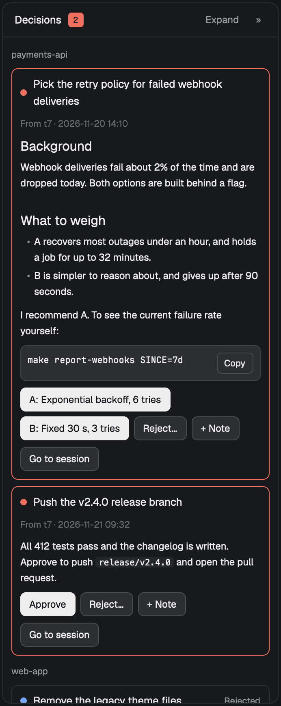

# decisions

Herdr 的側邊面板，集中列出各個 agent session 等你決定的事。[English](README.md)



同時跑好幾個 agent session 時，它們要問你的事散落在各個對話裡，很容易不知道有哪些在等你。
裝了這個 mod 之後，需要你決定的 session 會在自己的專案裡寫一個小小的 markdown 檔，面板把所有待決策的檔案連同判斷資訊列出來。
你按下選擇，面板把結果寫回檔案並通知 session。

## 功能

- 列出每個有開 pane 的專案的 `.decisions/*.md`，依提出決策的 space 分組。
- 上方有一排小 tab，每個 space 一個並標出待決策數量，點了只看那個 space。
- session 提供幾個選項就有幾顆按鈕；沒提供選項就是「核准」。
- 駁回時先輸入原因，原因會一起送給 session，讓它知道後續怎麼處理。
- 每個程式碼區塊旁有「複製」按鈕，方便複製要你親自執行的指令。
- 有新決策時跳通知，Dock 圖示顯示待決策數量。
- 可以放大到整個 tab 區域閱讀，也可以收成只顯示數量的 44 px 窄條。

## 運作方式

```
session                         面板                           你
  │ 寫入 .decisions/<id>.md       │                              │
  │（status: pending）───────────▶│ 顯示卡片、跳通知 ────────────▶│
  │                               │◀──────────────── 按下選擇    │
  │                               │ 改寫 frontmatter             │
  │◀─── hc send <requester> ──────│（status: decided）           │
  │ 重新讀檔、執行，               │                              │
  │ 把檔案移到 .decisions/done/ ──▶ 卡片消失                      │
```

檔案內容是唯一依據；送給 session 的訊息只是提醒它去讀檔。

## 設定

1. 安裝 mod：在 repo 根目錄執行 `./sync install decisions`。
2. 把區塊加進版面，放在包含 tab 區塊的那一列（Herdr `main` 版面的 `work-body`）。
   內建版面是唯讀的，先用 `herdr-app do layout.clone '{"name":"main"}'` 複製一份。

   ```json
   { "id": "decisions", "type": "block", "content": { "mod": "decisions", "props": { "lang": "zh-TW" } }, "size": { "px": 340 }, "min": 44 }
   ```

3. 讓 agent 知道這個約定：把 [`agent-rule.zh-TW.md`](agent-rule.zh-TW.md) 複製到 agent 讀規則的位置。
   Claude Code 是專案裡的 `.claude/rules/decisions.md`，或對所有專案生效的 `~/.claude/rules/`。
4. 不想把待決策檔 commit 進去的話，在 `.gitignore` 加上 `.decisions/`。
5. 選用，Claude Code 適用：安裝下面的防呆 hook，agent 忘記約定時會被提醒。

### Claude Code 的防呆 hook

約定就算已經在 agent 的 context 裡，它還是可能只在對話裡問、沒寫決策檔，這時面板上什麼都看不到。
[`hooks/decision-file-guard.py`](hooks/decision-file-guard.py) 是一個 Stop hook，專門擋這種情況：
回覆裡有請你決定的句型（「請你決定」「等你核准」、"your call"…），而這個終端在這一輪沒有寫 pending 的決策檔時，
它會把 agent 擋回去一次，要它補寫決策檔，或說明其實不需要決定。

```sh
mkdir -p ~/.claude/hooks
cp decisions/hooks/decision-file-guard.py ~/.claude/hooks/
```

再把它加進 `~/.claude/settings.json` 的 `Stop` hooks：

```json
{ "matcher": "", "hooks": [{ "type": "command", "command": "python3 ~/.claude/hooks/decision-file-guard.py", "timeout": 10 }] }
```

- 同一則回覆最多擋一次，session 不會卡住。
- 回覆是在指向面板上已經 pending 的決策時會放行。
- 不在 Herdr 裡（沒有 `HC_TERMINAL_ID`）或不在 git repo 時不作用。
- 它是比對句型，所以回報「你決定了 A，已經做完」也會中，代價是多一輪回覆。

### 選項

寫在區塊的 `content.props`：

| Prop | 預設 | 意義 |
|---|---|---|
| `lang` | `"en"` | 介面與送給 session 的訊息語言：`"en"` 或 `"zh-TW"`。 |
| `block` | `"decisions"` | 這個區塊在版面裡的 id，改過名稱時才需要。 |
| `roots` | 無 | 指定要顯示的專案資料夾，取代「有開 pane 的專案」。有 `roots` 的複本只負責顯示，不跳通知、不動 Dock 數字。 |

## 決策檔

`<git 根目錄>/.decisions/<日期>-<代號>.md`：

````markdown
---
title: 決定 webhook 傳送失敗的重試策略
status: pending
requester: t7
created: 2026-11-20 14:10
options: ["A：指數退避，重試 6 次", "B：固定 30 秒，重試 3 次"]
---
## 背景
為什麼現在需要決定。

## 判斷資訊
每個選項的成本與風險，以及 session 的建議。

```sh
make report-webhooks SINCE=7d
```
````

| 欄位 | 誰寫 | 意義 |
|---|---|---|
| `title` | session | 一句話講清楚要決定什麼。 |
| `status` | 兩邊 | `pending`，你按下後變成 `decided`。 |
| `requester` | session | session 的 `$HC_TERMINAL_ID`，結果會送到這裡。 |
| `created` | session | 顯示在卡片上。 |
| `options` | session | 寫在同一行的 JSON 陣列。只需要核准或駁回時省略。 |
| `decision` | 面板 | 你按的選項文字，或 `approved`、`rejected`。 |
| `note` | 面板 | 你的備註，或駁回原因。 |
| `decided_at` | 面板 | 按下的本地時間。 |

每個欄位一行，不支援多行 YAML 值。[`demo/`](demo/) 有範例檔，把 `roots` 指過去就能在沒有真實 session 的情況下試用面板。

## 限制

- 只支援本機專案，其他機器上的 pane 會被略過。
- 通知 session 用的是 `hc send`，agent 會把它當成通知而不是你的指令。約定檔要求 agent 重新讀決策檔並照做，但沒有強制機制。防呆 hook 只管另一個方向：agent 問了卻沒寫決策檔。
- Dock 數字是所有 mod 共用的，最後設定的那個生效。
- 放大是把版面裡 id 為 `main` 的區塊隱藏；版面沒有這個區塊就不能放大。

## 開發

```sh
npm test    # 在 repo 根目錄執行
```

`decision-file.js`（檔案格式）、`groups.js`（依 space 分組）和 `strings.js`（兩種語言）有對應的測試，在 [`test/`](test/)；防呆 hook 也有，`npm test` 會用 Python 的 `unittest` 一起跑。
[`RECIPE.md`](RECIPE.md) 是給 agent 重建這個 mod 用的說明。
