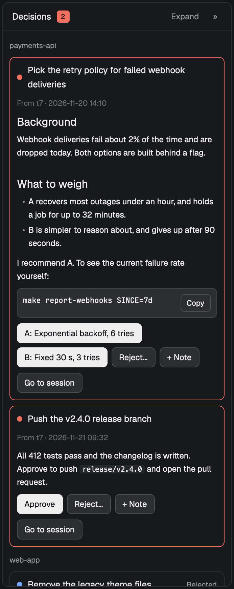

# Decisions

A side panel that lists the decisions agent sessions are waiting on, across every project with an
open pane, on this machine and on the other machines Herdr is connected to. Each decision is a
markdown file the session wrote in its project. The person reads the context in the panel, clicks a
choice or rejects with a reason, and the panel writes the result back to the file and tells the
session.

## What you see

- A block on the right of the work area, 340 px wide, drawn as a card (10 px radius, 1 px border,
  theme `background`).
- Header, 42 px: "Decisions", a count pill (`blocked` color when above zero), "Expand" / "Restore", and "»".
- A scrolling list grouped by space. A decision belongs to the space its `requester` terminal is
  in; when that terminal is gone, to a space with a pane in the project; otherwise the project is
  its own group. The focused space's name is accented. Pending cards come first in each group,
  projects keep the order of their first panes across machines, and a card's meta line names its
  project. Until every machine of the first refresh has finished one read, worked or not, an empty
  list says "Loading…".
- With more than one group, a wrapping row of small tabs under the header: "All" and one per group,
  each with its pending count. Clicking one shows only that group.
- A decision card: status dot, title, "<project> · From <who> · <created>", the body as rendered
  markdown, then buttons. A project on another machine is named "<folder> @<machine>". <who> is the
  requester's pane name, else its tab's name when someone named the tab, else its address. When
  another terminal pane in that tab goes by the same name, " · tN" (its terminal id) is added; if
  that is still shared, the full address is shown. A label that still meets another pane's in the
  tab, as when a pane is named after another's address, gets " (<address>)" until none is shared.
  Pending cards have a `blocked`-colored border
  and start open; decided ones start folded and show the decision beside the title.
- Each fenced code block in the body is drawn as its own box in the terminal font with a "Copy"
  button.
- Folded to a 44 px rail: only the count in a circle and "Decide".
- A message strip at the bottom, one line each: "Can't reach <machine>" for a machine that can't be
  reached (", showing the last read" when its last cards are still shown), "<project>: read failed
  (<why>)" for a project whose read failed, then the last write or notification result.

## How it behaves

- Reads `<git root>/.decisions/*.md` (not subfolders) for every pane's folder. A remote pane's id
  carries a `machine/` prefix; its folder is read on that machine with `exec` and `readTextFile`
  passing `on`, and keyed `machine:path` so equal paths on two machines stay apart. The git root is
  cached only when git confirmed it: the root it printed, or the folder itself when git says it is
  not a repository. A lookup that could not run or failed otherwise reads the folder for that round
  and asks git again next refresh; such a read only adds cards and updates those it finds, and
  never removes one.
- It refreshes when a local `.decisions` folder changes and every 15 seconds. Each machine reads
  on its own and its cards update when it finishes, so a slow machine holds up no other. Each
  machine reads again after its current read when a refresh came in meanwhile.
- On another machine each round starts with `exec("true")`, and that probe, `git` and `find` give
  up after 5 s (`timeout: 5000`). Calls on this machine and the decision write-back keep `exec`'s
  default.
- A machine is unreachable only when Herdr's `machines()` lists it `unavailable` or the probe is
  refused or does not exit 0 (as when it times out). Its projects then keep their last read under the "Can't reach" line. Once the probe
  answered, a failed command fails only its project, which keeps its last read and shows "read
  failed"; the machine's other projects update. A missing `.decisions` folder is an empty project.
- A machine's last read is kept while it has panes or is not ready, and dropped once it has no
  pane and `machines()` lists it `ready`.
- A decision that appears after a machine's baseline posts a notification. A machine gets its
  baseline from its first read of a project under a confirmed git root that read without error;
  reads before that, on a machine reached later too, only set what has been seen. Decisions are tracked by
  machine and path, so a machine that comes back posts nothing again. The Dock badge shows the
  pending count, which keeps an offline machine's last read.
- Buttons: one per entry in the file's `options`, or "Approve" when there are none; "Reject…"; "+ Note";
  "Go to session" (`agent.focus` on the requester's full address).
- "Reject…" swaps the buttons for a focused reason field with "Send rejection" and "Cancel"; Enter submits.
- Deciding rewrites the frontmatter: `status: decided`, `decision` (the option text, `approved` or
  `rejected`), `note`, `decided_at`. On this machine it writes with `writeTextFile`, falling back to
  `sh -c 'printf %s "$1" > "$2"'` when that refuses; on another machine it writes with that shell
  command on the file's machine. It then runs `hc send <requester> <text>` with the full address (a
  remote session's bare `$HC_TERMINAL_ID` becomes `machine/tN`); a rejection's text carries the
  reason and tells the session not to proceed as proposed. "Told …" and "could not be told" lines
  name the requester the way the card does.
- A decided card offers "Notify again". It leaves the panel when the session moves the file to
  `.decisions/done/`.
- "Expand" hides the tab block and gives the panel its room (content centered, 860 px wide at most);
  "Restore" brings it. Pane zoom (`pane.zoom`) is separate.
- "»" resizes the block to the rail; clicking the rail opens it to 340 px.

## Built from

- Layout: one block appended to the row that holds the tab block (`work-body` in Herdr's `main`):
  `{ "id": "decisions", "type": "block", "content": { "mod": "decisions" }, "size": { "px": 340 }, "min": 44 }`.
  The tab block's id must be `main`. Pass `props: { "block": "<id>" }` if the block has another id.
  Shipped layouts are read-only: `layout.clone` first.
- `mods/decisions/main.js` is the view. These have no Herdr imports, so `node --test` covers them:
  `decision-file.js` (parsing and rewriting the file), `groups.js` (grouping by space),
  `places.js` (machine prefixes, place keys, requester addresses and labels, where spaces,
  terminals and projects are, merging the machines' reads, which decisions to announce), `refresh.js` (the `Refresher`: reading every machine, with
  Herdr's I/O passed in; the timer and the folder watch call its `refresh()`), `tell.js` (`hc send`,
  with `hc` passed in), `strings.js` (English and Traditional Chinese). `mod.json` is
  `{ "place": "none" }`.
- Props: `lang` (`"en"` default, `"zh-TW"`), `block` (the block's id), `roots` (folders on this
  machine to show as they are instead of the open panes' projects; such a copy reads no other
  machine, posts no notifications, sets no badge, and groups no project by a pane's folder).
- `herdr`: `panes`, `spaces`, `machines`, `focused`, `layout`, `props`, `theme`, `settings`, `exec`
  (`true` as a probe, `git rev-parse`, `find`, a shell fallback for writing), `hc` (`send`),
  `readTextFile`, `writeTextFile`, `watchFolder`, `notify`, `setBadge`, `checking`, `run`
  (`layout.resize`, `layout.show`, `layout.hide`, `agent.focus`).
- `gpui-base`: `InputState`, `Input`, `TextView.markdown`, `Scrollbar`. Copying uses
  `cx.write_to_clipboard`.
- The agents' side is a convention, not code: `agent-rule.md` tells a session when and how to write
  a decision file. Put it where the agent reads its rules (for Claude Code,
  `.claude/rules/decisions.md` in a project or `~/.claude/rules/`).

## Watch out

- `InputState.new` cannot run during render. The note and reason fields are created in click
  handlers.
- Herdr does not hot-reload a mod folder that is a symlink. Keep a real folder in `mods/`.
- The frontmatter parser reads one `key: value` per line. `options` must be a JSON array on one
  line; multi-line YAML values are not read.
- The result reaches the session as an `hc send` message, which agents treat as a notice rather
  than the person's instruction. The file is the source of truth; the rule tells sessions to
  re-read it.
- `watchFolder` and `writeTextFile` take no `on` and only work on this machine. A remote project
  is seen on the 15 second refresh, not when its folder changes, and is written through `sh` there.
- Remote reads need a timeout: `exec` waits 30 s by default. Keep machines independent too; one
  shared "loading" flag would let a slow machine hold back this machine's updates.
- `exec` rejects for a missing command, a missing `cwd` and an unreachable machine alike, so only
  the probe or `machines()` decides that a machine is unreachable.
- `setBadge` is shared by all mods; the last caller wins.
- Zoom state is read from the layout (`main` hidden), so a layout without a `main` block cannot
  zoom.
- Every string the person or a session sees comes from `strings.js`; add a language there, and the
  test checks it defines every key.

## Done when

- `npm test` passes, `herdr-app check mods/decisions` passes and `herdr-app status` lists no errors.
- A file in `<project>/.decisions/` with `status: pending` shows up within a few seconds, with a
  notification and a Dock badge. On another machine it shows up within 15 seconds.
- With another machine's core stopped, its cards stay with "Can't reach <machine>, showing the last
  read", the badge keeps its count, and nothing is notified again when it comes back.
- Clicking an option writes `status: decided` and the choice to the file, and the requester
  terminal receives the message.
- Rejecting with a reason writes `decision: "rejected"` and the reason in `note`, and the message
  carries the reason.
- A code block's "Copy" puts exactly that block on the clipboard.
- "Expand" and "Restore" swap the panel and the tab area; "»" and the rail fold and unfold it.
- Moving the file to `.decisions/done/` removes the card.
